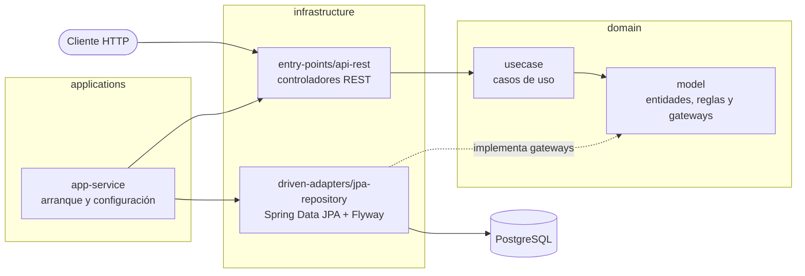
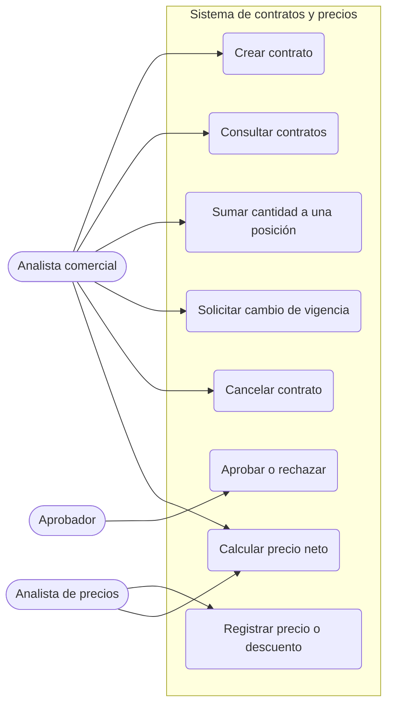
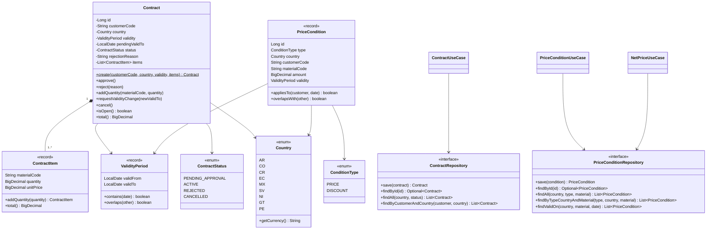
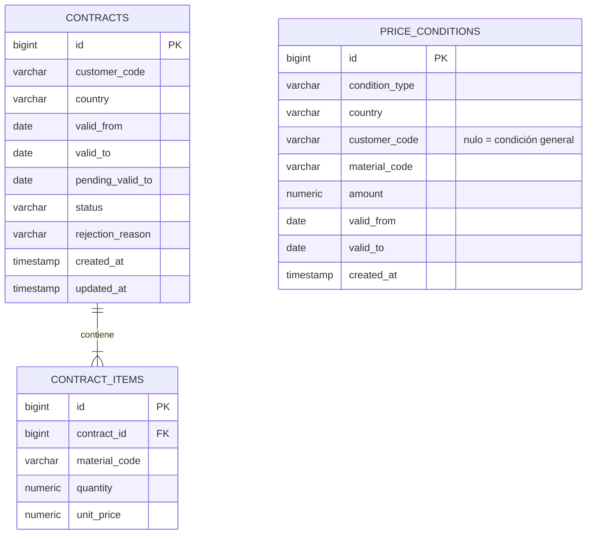
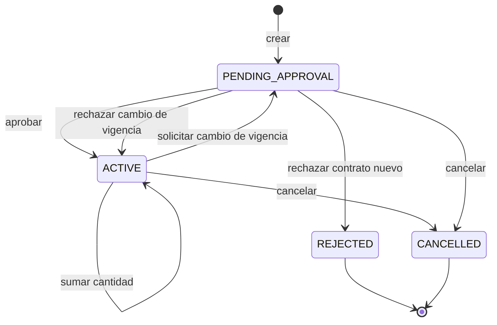
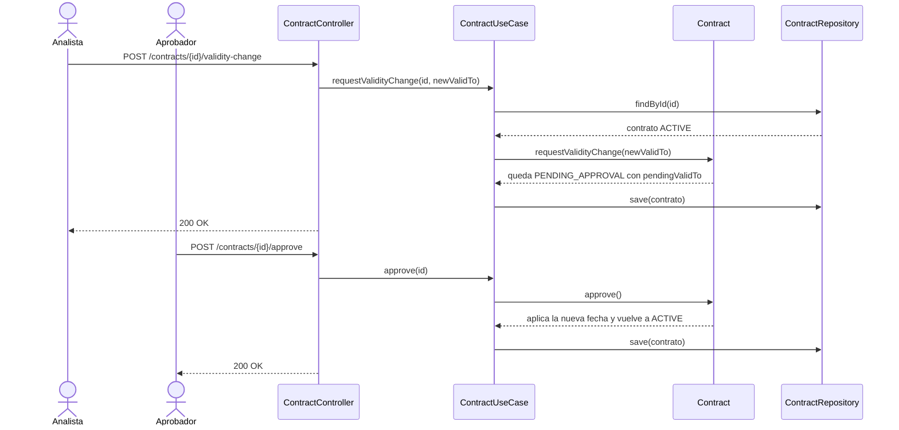

# Diagramas

Todos los diagramas están en Mermaid, así que GitHub los muestra directamente.

## 1. Arquitectura (capas y dependencias)

Las dependencias apuntan siempre hacia el dominio. El dominio no conoce Spring, JPA ni HTTP.

## 2. Casos de uso

## 3. Diagrama de clases del dominio

## 4. Modelo entidad-relación

## 5. Estados de un contrato

Sumar cantidad no requiere aprobación. Si se rechaza un cambio de vigencia, el contrato sigue activo con la vigencia anterior.

## 6. Secuencia: cambio de vigencia con aprobación

